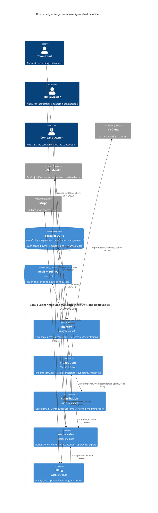

# Architecture map — Bonus Ledger

> The **target foundation** of Bonus Ledger, produced by `map-architecture` in greenfield mode and read by
> write-prd / architecture-design / generate-data-model / implement-tasks. At `reflects_commit` the repo holds
> only docs, module READMEs and `.claude/rules/`; every path below is what the scaffold creates. Once
> `/sdlc:implement-tasks _scaffold` has run, refresh this map with `/sdlc:map-architecture` (it then runs in
> brownfield mode and replaces the doc citations with `file:line` anchors in code).
>
> This map is generated. The authored sources are authoritative and are linked, not copied:
> `CLAUDE.md`, `ARCHITECTURE.md`, `docs/bc-map.md`, `docs/adr/`, `SPEC.md`, `.claude/rules/`.

## Stack

- Language / runtime: TypeScript (strict), Node.js 22 (`CLAUDE.md` §Stack, `docs/adr/0001-initial-setup.md:14`)
- Frameworks: NestJS 11 (HTTP + modules), `@nestjs/event-emitter` (in-process event bus), BullMQ on Redis (queued jobs) (`CLAUDE.md` §Stack, `ARCHITECTURE.md:33-35`)
- Datastore: PostgreSQL 16 via Prisma, one Postgres schema **and one Prisma schema/client** per context (`docs/adr/0002-persistence-per-context-prisma.md`)
- Package manager: pnpm only (not npm, not yarn)
- Build / test / lint (created by the scaffold; feed `implement-tasks` detection). On Windows `make` is not installed: run `pnpm` directly.

| Purpose | Command |
|---|---|
| Install | `pnpm install --frozen-lockfile` |
| Local infra | `docker compose up -d postgres redis` |
| Dev server | `pnpm start:dev` |
| Build | `pnpm build` |
| Type-check | `pnpm typecheck` |
| Lint (incl. context boundaries) | `pnpm lint` |
| All tests | `pnpm test` |
| Unit tests only | `pnpm test:unit` |
| Integration + e2e tests | `pnpm test:int` |
| Single test file | `pnpm test src/modules/contribution/<file>.spec.ts` |
| Generate Prisma clients | `pnpm db:generate` |
| Apply migrations (all contexts) | `pnpm db:migrate` |
| New migration for one context | `pnpm db:migrate:dev <context> <name>` |

## C4 — target baseline

Context level: Team Lead, HR Reviewer and Company Owner use one deployable; it calls Jira Cloud, the Claude API and (later) Stripe.



Not drawn, to keep the diagram readable: `TeamMemberInvited` (identity → contribution) and `SubscriptionSuspended` (billing → integrations). Every context accesses only its own Postgres schema. The complete event graph is `docs/bc-map.md` §3.

## Module inventory

Folder names, schemas and inner structure are from `docs/bc-map.md` §4. They are fixed and must not be extended with new contexts (a new context requires a `bc-map.md` update and an ADR first, see `CLAUDE.md` §Architecture).

| Module | Path | Postgres schema | Inner layout | Public facade (`public/`) | Wired at | Responsibility |
|---|---|---|---|---|---|---|
| Identity & Teams | `src/modules/identity/` | `identity` | handler / service / repo, grouped by feature | `TeamDirectory` + event types (`src/modules/identity/README.md:7`) | `src/app.module.ts` (target) | Tenants, teams, members, roles, HR reviewers, auth, invitations |
| Jira Integration | `src/modules/integrations/` | `integrations` | per-provider folder `jira/` with client / mapper / sync service (the mapper is the ACL) | event types only (`src/modules/integrations/README.md:7`) | `src/app.module.ts` (target) | Connections (encrypted tokens), sync runs, issue/worklog/sprint snapshots |
| Contribution Scoring | `src/modules/contribution/` | `contribution` | `domain/` / `app/` / `infra/` (core domain) | `ScoreQuery` + event types (`src/modules/contribution/README.md:7`) | `src/app.module.ts` (target) | `ContributionScore` from `Weighted Effort`, `Capacity`, `Team Baseline` |
| Bonus Review | `src/modules/bonus-review/` | `bonus_review` | handler / service / repo | event types only (`src/modules/bonus-review/README.md:7`) | `src/app.module.ts` (target) | Bonus Period state machine, Justification, Recommendation, Approval, export |
| Billing | `src/modules/billing/` | `billing` | handler / service / repo; Stripe behind one adapter | `SubscriptionStatus` + event types (`src/modules/billing/README.md:7`) | `src/app.module.ts` (target) | Plan, Subscription, Invoice, Grace Period |
| Shared kernel | `src/shared/` | none | `ids/`, `clock/`, `money/`, `events/` (bus + outbox), `errors/`, `config/` | n/a (importable by all modules) | each module imports what it needs | Technical primitives only, no business rules, no imports from `src/modules/` (`src/shared/README.md:3`) |

Target layout of one module, using `bonus-review` (handler / service / repo) and `contribution` (domain / app / infra):

```
src/modules/bonus-review/
  bonus-review.module.ts       NestJS module; the only file app.module.ts imports
  public/                      facade + published event types: the only path other contexts may import
    index.ts
  periods/                     one folder per feature
    periods.controller.ts      handler (HTTP)
    periods.listener.ts        handler (domain events / jobs)
    periods.service.ts         service
    periods.repo.ts            repo (the only code that touches the Prisma client)
    periods.service.spec.ts    unit test, next to the code
  db/
    schema.prisma              Prisma schema for bonus_review only
    migrations/                this context's own migration history
    client.ts                  Nest provider for this context's generated client
    generated/                 generated Prisma client (gitignored)

src/modules/contribution/
  contribution.module.ts
  public/
  domain/                      pure scoring: (evidence, WeightingPolicy version) → ContributionScore; no I/O, no Nest
  app/                         use cases, event listeners, ScoreQuery implementation
  infra/
    db/                        schema.prisma, migrations/, client.ts, generated/
```

The inner layout of `identity`, `billing` and `integrations` follows the `bonus-review` example (for `integrations`, provider code sits under `jira/`).

## Conventions (the rules a new feature must match)

All of these are target conventions: each one names its authored source, or the scaffold task that creates the first example in code.

- **Module wiring / registration:** every context is one NestJS module (`<context>.module.ts`), imported once in `src/app.module.ts`, the composition root (`ARCHITECTURE.md:16`). A module exports only its `public/` facade providers. *First example:* scaffold `S1`.
- **Dependency rule (lint-enforced from day one):** `modules/A` may import only `modules/B/public/**` and `shared/**`. `shared` imports nothing from `modules`. No import cycles (`ARCHITECTURE.md:23-29`, `CLAUDE.md` §Architecture). Enforced by `eslint-plugin-boundaries` plus a no-cycle rule in `pnpm lint`. A lint self-test proves that a forbidden import fails. *First example:* scaffold `S7`.
- **Error handling:** typed domain errors extend `DomainError` from `src/shared/errors/` and carry a stable `code` (e.g. `JUSTIFICATION_SELF_APPROVAL`). One global NestJS exception filter maps them to HTTP status codes and a single envelope `{ error: { code, message, details? } }`. Unknown errors become 500 and never leak stack traces or provider payloads. Services throw domain errors, never `HttpException`. *First example:* scaffold `S6`.
- **IDs:** UUIDv7, generated in the application by `src/shared/ids/` (`newId()`), never by the database. Stored as Postgres `uuid`. Other contexts' data is referenced only by id, with no cross-schema foreign keys (`ARCHITECTURE.md:25`). *First example:* scaffold `S5`. Decision: `docs/adr/0002-persistence-per-context-prisma.md`.
- **Time:** dates are stored in UTC. A bonus period is a calendar month `YYYY-MM` in the company's timezone (`CLAUDE.md` §Conventions). Code reads the time through the injected `Clock` from `src/shared/clock/`, never through `Date.now()` (required in `contribution`: `.claude/rules/contribution.md:10`). *First example:* scaffold `S5`.
- **Money:** integer minor units `amountCents` plus an ISO currency code, never floats (`.claude/rules/money.md:9`). Implemented as `Money` in `src/shared/money/`. *First example:* scaffold `S5`.
- **Persistence / DB access:** each context has its own `schema.prisma`, its own generated client inside its folder and its own Postgres schema. Only `*.repo.ts` (or `infra/` in `contribution`) touches the client. Cross-schema joins are forbidden (`ARCHITECTURE.md:25`). Because the client is inside the module folder, the boundaries lint rule also stops other contexts from importing it. "DB as dumb storage": no triggers and no business defaults in SQL. *First example:* scaffold `S4`.
- **Migrations:** Prisma Migrate, one history per context in `src/modules/<context>/db/migrations/<timestamp>_<name>/migration.sql` (`contribution`: `infra/db/migrations/`). The `_prisma_migrations` table lives in the context's own schema. Prisma migrations are forward-only, so each migration folder also holds a hand-checked `down.sql`, applied with `prisma db execute` followed by `prisma migrate resolve --rolled-back`. `generate-data-model` stages `*.up.sql`/`*.down.sql`, and `implement-tasks` promotes them into this layout. *First example:* scaffold `S4`.
- **Tests:** Jest. Unit tests are `*.spec.ts` next to the code and need no database. Integration and e2e tests are `test/**/*.int-spec.ts` and `test/**/*.e2e-spec.ts`; they run against real Postgres and Redis from `docker compose` and call HTTP through Supertest. Provider fixtures with fake people go in `test/fixtures/<provider>/` (`.claude/rules/integrations.md:13`). A real provider is never called. Scoring changes need table-driven worked examples (`.claude/rules/contribution.md:15`). New behaviour starts with a failing test (`CLAUDE.md` §Conventions). *First example:* scaffold `S2`.
- **Inter-module communication:** events first. A publisher writes a past-tense domain event (`SprintClosed`) to its **own outbox table in the same transaction** as the state change. A relay job (BullMQ) publishes outbox rows on the in-process `@nestjs/event-emitter` bus. Delivery is at-least-once, so consumers deduplicate by `eventId`. A synchronous call goes only through another context's `public/` facade, and only for queries that need fresh data (`ARCHITECTURE.md:26,35`). Event names and payload terms come from `docs/bc-map.md` only. *First example:* scaffold `S9`.
- **Jobs:** Jira sync, scoring and the outbox relay run as BullMQ jobs on Redis, triggered by a schedule or by events (`ARCHITECTURE.md:34`). *First example:* scaffold `S8`.
- **Configuration and secrets:** environment variables are validated at boot (the app fails fast on a missing or invalid variable) and listed in `.env.example`. Jira tokens are encrypted at rest and decrypted only in the HTTP client (`.claude/rules/integrations.md:10`). Tokens, headers and full provider payloads are never logged. *First example:* scaffold `S3`.
- **Naming:** domain terms are written exactly as in `docs/bc-map.md` (`ContributionScore`, never `Rating` or `Points`; Jira's `storyPoints` stays in `integrations`; the scoring quantity is `Weighted Effort`) (`CLAUDE.md` §Conventions, `docs/bc-map.md:108-114`).
- **Commits:** Conventional Commits with the context as scope, e.g. `feat(contribution): ...` (`CLAUDE.md` §Conventions).
- **CI:** one GitHub Actions workflow (`.github/workflows/ci.yml`) runs install → `db:generate` → lint → typecheck → build → `db:migrate` → tests, with Postgres 16 and Redis as service containers. *First example:* scaffold `S10`.
- **UI / styling:** N/A, no frontend (see below).

## Datastores

| Store | Engine | Accessed via | Notes |
|---|---|---|---|
| `identity` schema | PostgreSQL 16 | identity's own Prisma client | Company is the tenant; every record carries `companyId` |
| `integrations` schema | PostgreSQL 16 | integrations' own Prisma client | Encrypted Jira tokens; issue snapshots upserted by natural key (key choice is open, see Constraints) |
| `contribution` schema | PostgreSQL 16 | contribution's own Prisma client (only `infra/`) | Read model of imported events; every score stores its `WeightingPolicy` version |
| `bonus_review` schema | PostgreSQL 16 | bonus-review's own Prisma client | Read-only after `BonusPeriodClosed` |
| `billing` schema | PostgreSQL 16 | billing's own Prisma client | Money as `amountCents` + currency |
| `<schema>.outbox` (one per context) | PostgreSQL 16 | the owning context, in the business transaction | `eventId` UNIQUE; relayed by a BullMQ job |
| Redis | Redis 7 | BullMQ (`@nestjs/bullmq`) | Queues only, not a system of record |

## Frontend / UI foundation

<!-- N/A: no frontend. The foundation is a REST API only (confirmed 2026-11-06). SPEC.md mentions a suspension banner and HR export; when a UI is added, a separate decision (ADR) must choose its stack, and this section must then record the design system, tokens and the closest UI precedent. -->

N/A: no frontend in the foundation. A future UI is an open decision and needs an ADR before any `ui`-layer task.

## Where things live / closest precedents

There is no code yet, so there are no precedents in code. Until the first feature ships, use these as templates:

- A new CRUD/workflow feature in `identity`, `bonus-review` or `billing` → `src/modules/<context>/<feature>/` with `*.controller.ts` / `*.listener.ts` / `*.service.ts` / `*.repo.ts`, modelled on the `bonus-review` layout above.
- A new scoring rule → `src/modules/contribution/domain/` as a pure function with a table-driven spec. A changed formula means a **new** `WeightingPolicy` version, never an edit (`.claude/rules/contribution.md:11`).
- A new Jira field or import → `src/modules/integrations/jira/` (client / mapper / sync service). `customfield_*` ids are mapped only there (`.claude/rules/integrations-jira.md:8`).
- A new cross-context event → add it to `docs/bc-map.md` first, then the publisher's `public/` event type, the publisher's outbox write and the consumer's deduplicating listener.
- A new table → `generate-data-model` stages SQL, which is promoted into `src/modules/<context>/db/migrations/` (`contribution`: `infra/db/migrations/`).
- After the scaffold, the first real precedent is whatever `S9` builds (outbox write → relay → deduplicating listener). Refresh this map so it cites that code.

## Constraints & known tech-debt

- **Open: the stable Jira issue identifier.** `.notes/decisions.md:25-29` proposes `jiraIssueId` as the upsert key, because Jira changes `issueKey` when an issue moves between projects. `.claude/rules/integrations-jira.md:9` says the natural key is the Jira issue key. This is not decided. The first `integrations` feature (PRD / ADR) must resolve it, and the rule file or the note must then be updated.
- **Open: other proposed import decisions** in `.notes/decisions.md` (upsert + `contentHash`, deterministic `eventId`, `updated` cursor, deletion detection) are marked "not confirmed" there. Treat them as input to the first `integrations` PRD, not as conventions.
- **Unassigned event `MemberAbsenceRecorded`** (`docs/bc-map.md:116-118`): until a context owns it, `Capacity` uses working days only.
- **Prisma multi-client setup is unverified.** Five schema files, five generated clients and five migration histories in one database is the chosen design (ADR 0002). Scaffold `S4` must prove it works on the pinned Prisma version before any feature migration is written.
- **Prisma migrations are forward-only.** Rollback depends on the hand-checked `down.sql` convention above.
- **No frontend yet.** Any UI work first needs a stack decision (ADR).
- **Out of scope for the MVP** (`SPEC.md:10-16`): bonus amounts and salaries, providers other than Jira Cloud, real-time dashboards, mobile, SSO/SCIM, public rankings.
- **Data rules:** Jira tokens are encrypted at rest. Employee data is deleted 90 days after a company cancels. Raw Jira comments are never sent to the Claude API (`SPEC.md:22-24`). Test data never contains real tokens, names or salaries (`CLAUDE.md` §Conventions).
- **Windows developer machine:** `make` is not available. Docs and tasks give `pnpm` commands, and the `Makefile` stays only as an alias.

## Reconciliation with the authored architecture doc

Authored sources: `ARCHITECTURE.md`, `CLAUDE.md`, `docs/bc-map.md`, `docs/adr/0001-initial-setup.md`, `SPEC.md`, module READMEs. This map follows all of them, with these deliberate refinements and drifts:

- **Boundaries lint timing (drift).** `ARCHITECTURE.md:29` says `eslint-plugin-boundaries` arrives "in CI (module 5)". The foundation enforces it from the scaffold (`S7`, decided 2026-11-06). `ARCHITECTURE.md:29` should be updated by hand. This map does not edit authored docs.
- **Persistence refinement.** "One schema per bounded context" (`CLAUDE.md` §Stack) is refined to one Postgres schema **plus one Prisma schema file and client** per context (ADR 0002). This is consistent with ADR 0001 and makes `ARCHITECTURE.md:25` checkable by the compiler.
- **Developer entry points.** ADR 0001 (`docs/adr/0001-initial-setup.md:15`) names `make dev` / `make test`. Those targets stay, but the canonical commands are `pnpm`, because `make` is not installed on the developer's machine.
- **Commands section.** `CLAUDE.md` §Commands says the commands "work once `package.json` and `docker-compose.yml` are scaffolded". The scaffold creates both and keeps those command names, so `CLAUDE.md` needs no change and was not modified.
- **`.env.example` not reviewed.** Reading it is denied by the local permission settings. Scaffold `S3` extends it with the new variables and should be reviewed by hand.
