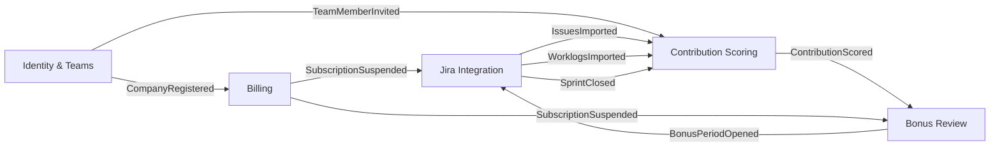

# Bounded Contexts Map — Bonus Ledger

## 1. Event Storming lite: 12 key events

| # | Event | Happens when |
|---|---|---|
| 1 | `CompanyRegistered` | A company owner signs up and creates a workspace |
| 2 | `TeamMemberInvited` | A team lead invites a member or an HR reviewer |
| 3 | `JiraConnected` | A team lead authorises the Jira integration for a project |
| 4 | `IssuesImported` | A sync pulls issues, story points and assignees from Jira |
| 5 | `WorklogsImported` | A sync pulls logged time from Jira |
| 6 | `SprintClosed` | A Jira sprint is closed and its final scope is frozen |
| 7 | `ContributionScored` | A member's monthly contribution score is calculated |
| 8 | `BonusPeriodOpened` | A new monthly bonus period starts for a team |
| 9 | `JustificationDrafted` | A bonus justification draft is generated for a member |
| 10 | `JustificationApproved` | HR approves the team lead's justification |
| 11 | `BonusPeriodClosed` | All justifications in a period are approved and the period is locked |
| 12 | `PaymentFailed` | The monthly subscription charge for a company fails |

Supporting events used in the map: `SubscriptionActivated`, `SubscriptionSuspended`.

## 2. Bounded Contexts and ubiquitous language

Five groups of events give five contexts.

### Identity & Teams (`identity`)
Events: `CompanyRegistered`, `TeamMemberInvited`.
- **Company**: the paying tenant; every record belongs to one company.
- **Team**: a group of members with one team lead, mapped to one or more Jira projects.
- **Member**: a person whose contribution is scored; has a role (Dev, QA, Lead, PM).
- **Reviewer**: an HR user who approves justifications; is not scored.

### Jira Integration (`integrations`)
Events: `JiraConnected`, `IssuesImported`, `WorklogsImported`, `SprintClosed`.
- **Connection**: an authorised link to a Jira site, stored with an encrypted token.
- **Sync Run**: one import pass; it is idempotent and resumable.
- **Imported Issue**: a snapshot of a Jira issue (key, type, story points, assignee, status history).
- **Sprint Snapshot**: the frozen scope and capacity of a closed sprint.

### Contribution Scoring (`contribution`)
Events: `ContributionScored`.
- **Contribution Score**: a member's weighted result for a month (0–100).
- **Weighting Policy**: the rules that turn story points, issue type and role into points.
- **Capacity**: a member's available working days in the sprint, adjusted for absences.
- **Team Baseline**: the team median used for relative comparison and the trend over previous months.

### Bonus Review (`bonus_review`)
Events: `BonusPeriodOpened`, `JustificationDrafted`, `JustificationApproved`, `BonusPeriodClosed`.
- **Bonus Period**: one calendar month for one team, with states Open → In Review → Closed.
- **Justification**: the formal text that explains a member's bonus, with evidence links.
- **Recommendation**: the suggested bonus tier (None / Standard / High / Exceptional).
- **Approval**: HR's sign-off on one justification; it cannot be changed after the period is closed.

### Billing (`billing`)
Events: `SubscriptionActivated`, `PaymentFailed`, `SubscriptionSuspended`.
- **Plan**: the price per team per month.
- **Subscription**: the company's active plan and billing cycle.
- **Invoice**: the monthly charge; it is paid, failed or void.
- **Grace Period**: the days after `PaymentFailed` before features are suspended.

## 3. BC Map

Each arrow means "listens to": the context at the arrow's head reacts to the event named on the arrow.

Relationships:
- **Jira Integration** is an Anti-Corruption Layer: Jira's model (custom fields, statuses) never leaks past it. Other contexts see only the published events.
- **Contribution Scoring** is the core domain: it holds the weighting rules, which are what makes the product different.
- **Billing** is generic and can later be replaced by Stripe Billing behind the same events.

## 4. Structure level

**Chosen: feature-first (modular monolith)**, with one module per context in `src/modules/<context>/`.

Why: there is one developer, five contexts and about 15 core entities. That is too many for **flat** (the folders would mix scoring rules with Jira mapping and billing). **Hexagonal** in every context would mean a lot of ports and adapters for CRUD-heavy contexts like Identity and Billing. Feature-first keeps the boundaries visible and enforceable through `public/` facades. If **Contribution Scoring** grows complex rules, it alone can move to hexagonal later, without restructuring the rest.
