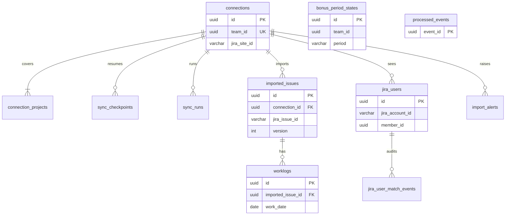

# Data model — jira-activity-import

Context: `integrations` (Postgres schema `integrations`, own Prisma client). Other contexts are referenced by id only — no cross-schema FK. Course defaults: UUIDv7 from the app, `created_at` only, hard delete, no CHECK/TRIGGER/business DEFAULT; enums live in the app.

**Aggregates:** Connection (owns Connection Projects, Sync Checkpoints, Sync Runs, Import Alerts); Imported Issue (owns its Worklogs); Jira User (owns its match events). Bonus Period State is a read model from Bonus Review events; Processed Event deduplicates consumed events. The outbox table comes from scaffold S9 and is not created here.

## ER diagram

## Entities

### `connections`

| Column | Type | Constraints | Notes |
|---|---|---|---|
| `id` | UUID | PK, app-generated (UUID v7) | |
| `company_id` | UUID | NOT NULL | Company (identity), no cross-schema FK |
| `team_id` | UUID | NOT NULL | Team (identity); one Connection per Team (AC-04) |
| `jira_site_id` | VARCHAR(64) | NOT NULL | Atlassian cloud id of the Jira Site |
| `jira_site_url` | TEXT | NOT NULL | site URL shown in Import Health |
| `encrypted_refresh_token` | BYTEA | NOT NULL | ADR 0007; encrypted at rest, never returned or logged |
| `authorised_by_member_id` | UUID | NOT NULL | who granted access last |
| `authorised_at` | TIMESTAMPTZ | NOT NULL | replaced on re-authorisation (AC-16) |
| `created_at` | TIMESTAMPTZ | NOT NULL DEFAULT now() | |

### `connection_projects`

| Column | Type | Constraints | Notes |
|---|---|---|---|
| `id` | UUID | PK, app-generated (UUID v7) | |
| `connection_id` | UUID | NOT NULL, FK → `connections(id)` | FK |
| `jira_project_id` | VARCHAR(32) | NOT NULL | stable Jira project id |
| `jira_project_key` | VARCHAR(32) | NOT NULL | display key |
| `story_point_field_id` | VARCHAR(64) | NULL | found by the system; NULL = not found (AC-17) |
| `created_at` | TIMESTAMPTZ | NOT NULL DEFAULT now() | |

### `bonus_period_states`

| Column | Type | Constraints | Notes |
|---|---|---|---|
| `id` | UUID | PK, app-generated (UUID v7) | |
| `team_id` | UUID | NOT NULL | Team (identity) |
| `period` | VARCHAR(7) | NOT NULL | YYYY-MM in the company timezone |
| `state` | VARCHAR(16) | NOT NULL | Open / InReview / Closed, set from Bonus Review events (ADR 0006); enum in app |
| `created_at` | TIMESTAMPTZ | NOT NULL DEFAULT now() | |

### `sync_checkpoints`

| Column | Type | Constraints | Notes |
|---|---|---|---|
| `id` | UUID | PK, app-generated (UUID v7) | |
| `connection_id` | UUID | NOT NULL, FK → `connections(id)` | FK |
| `jira_project_id` | VARCHAR(32) | NOT NULL |  |
| `period` | VARCHAR(7) | NOT NULL | YYYY-MM |
| `cursor_at` | TIMESTAMPTZ | NULL | NULL = import the whole period (AC-05, AC-16) |
| `created_at` | TIMESTAMPTZ | NOT NULL DEFAULT now() | |

### `sync_runs`

| Column | Type | Constraints | Notes |
|---|---|---|---|
| `id` | UUID | PK, app-generated (UUID v7) | |
| `connection_id` | UUID | NOT NULL, FK → `connections(id)` | FK |
| `period` | VARCHAR(7) | NOT NULL | YYYY-MM |
| `kind` | VARCHAR(16) | NOT NULL | Daily / FinalPass; enum in app |
| `scheduled_for` | DATE | NOT NULL | idempotency of the scheduled job |
| `status` | VARCHAR(16) | NOT NULL | Running / Succeeded / Failed / Paused; enum in app |
| `failure_reason` | VARCHAR(64) | NULL | AccessLost / Throttled / ... |
| `started_at` | TIMESTAMPTZ | NOT NULL |  |
| `finished_at` | TIMESTAMPTZ | NULL |  |
| `created_at` | TIMESTAMPTZ | NOT NULL DEFAULT now() | |

### `imported_issues`

| Column | Type | Constraints | Notes |
|---|---|---|---|
| `id` | UUID | PK, app-generated (UUID v7) | |
| `connection_id` | UUID | NOT NULL, FK → `connections(id)` | FK |
| `jira_issue_id` | VARCHAR(32) | NOT NULL | stable identity (ADR 0002) |
| `jira_issue_key` | VARCHAR(32) | NOT NULL | mutable attribute, changes on move |
| `jira_project_id` | VARCHAR(32) | NOT NULL |  |
| `issue_type` | VARCHAR(64) | NOT NULL |  |
| `story_points` | NUMERIC(8,2) | NULL | NULL when the field is not found |
| `assignee_account_id` | VARCHAR(128) | NULL | Jira User |
| `resolved_at` | TIMESTAMPTZ | NULL | period membership by resolution date |
| `status_history` | JSONB | NOT NULL | opaque provider history, read only by contribution mapping |
| `content_hash` | CHAR(64) | NOT NULL | ADR 0003 |
| `version` | INTEGER | NOT NULL | bumped on every real change; part of eventId |
| `withdrawn_at` | TIMESTAMPTZ | NULL | AC-27 withdrawal; kept because Closed periods must not change |
| `created_at` | TIMESTAMPTZ | NOT NULL DEFAULT now() | |

### `worklogs`

| Column | Type | Constraints | Notes |
|---|---|---|---|
| `id` | UUID | PK, app-generated (UUID v7) | |
| `connection_id` | UUID | NOT NULL, FK → `connections(id)` | FK |
| `imported_issue_id` | UUID | NOT NULL, FK → `imported_issues(id)` | FK |
| `jira_worklog_id` | VARCHAR(32) | NOT NULL | stable Jira id |
| `author_account_id` | VARCHAR(128) | NOT NULL | Jira User |
| `work_date` | DATE | NOT NULL | day covered, company timezone; period membership |
| `duration_seconds` | INTEGER | NOT NULL |  |
| `content_hash` | CHAR(64) | NOT NULL |  |
| `version` | INTEGER | NOT NULL |  |
| `withdrawn_at` | TIMESTAMPTZ | NULL | AC-27 |
| `created_at` | TIMESTAMPTZ | NOT NULL DEFAULT now() | |

### `jira_users`

| Column | Type | Constraints | Notes |
|---|---|---|---|
| `id` | UUID | PK, app-generated (UUID v7) | |
| `connection_id` | UUID | NOT NULL, FK → `connections(id)` | FK |
| `jira_account_id` | VARCHAR(128) | NOT NULL |  |
| `display_name` | VARCHAR(255) | NOT NULL | personal data (PRD §6.1) |
| `email` | VARCHAR(320) | NULL | only when Jira exposes it |
| `member_id` | UUID | NULL | current match; NULL = unmatched |
| `not_on_team` | BOOLEAN | NOT NULL | AC-28; value set by app |
| `created_at` | TIMESTAMPTZ | NOT NULL DEFAULT now() | |

### `jira_user_match_events`

| Column | Type | Constraints | Notes |
|---|---|---|---|
| `id` | UUID | PK, app-generated (UUID v7) | |
| `jira_user_id` | UUID | NOT NULL, FK → `jira_users(id)` | FK |
| `action` | VARCHAR(16) | NOT NULL | Match / Unmatch / NotOnTeam / UndoNotOnTeam; append-only audit (PRD §6.1) |
| `member_id` | UUID | NULL |  |
| `actor_member_id` | UUID | NOT NULL | who did it |
| `created_at` | TIMESTAMPTZ | NOT NULL DEFAULT now() | |

### `import_alerts`

| Column | Type | Constraints | Notes |
|---|---|---|---|
| `id` | UUID | PK, app-generated (UUID v7) | |
| `connection_id` | UUID | NOT NULL, FK → `connections(id)` | FK |
| `kind` | VARCHAR(32) | NOT NULL | AccessLost / FieldMissing / UnmatchedUser / QuietProject |
| `subject_ref` | VARCHAR(128) | NOT NULL | project id or Jira account id; '-' for AccessLost (set by app) |
| `opened_at` | TIMESTAMPTZ | NOT NULL |  |
| `closed_at` | TIMESTAMPTZ | NULL |  |
| `created_at` | TIMESTAMPTZ | NOT NULL DEFAULT now() | |

### `processed_events`

| Column | Type | Constraints | Notes |
|---|---|---|---|
| `event_id` | UUID | PK | `eventId` of a consumed event (Bonus Period, Subscription); consumer dedup |
| `created_at` | TIMESTAMPTZ | NOT NULL DEFAULT now() | |

## Indexes

| Index | Columns | Query it serves |
|---|---|---|
| `uq_connections_team` (unique) | `team_id` | invariant + upsert key on `connections` |
| `idx_connections_company` | `company_id` | tenant scoping on every Connection read (AC-03) |
| `uq_connection_projects` (unique) | `connection_id, jira_project_id` | invariant + upsert key on `connection_projects` |
| `uq_bonus_period_states` (unique) | `team_id, period` | invariant + upsert key on `bonus_period_states` |
| `uq_sync_checkpoints` (unique) | `connection_id, jira_project_id, period` | invariant + upsert key on `sync_checkpoints` |
| `uq_sync_runs_schedule` (unique) | `connection_id, kind, period, scheduled_for` | invariant + upsert key on `sync_runs` |
| `idx_sync_runs_last_success` | `connection_id, status, finished_at DESC` | last successful Sync Run and Final Pass status in Import Health (AC-13, AC-23) |
| `uq_imported_issues` (unique) | `connection_id, jira_issue_id` | invariant + upsert key on `imported_issues` |
| `idx_imported_issues_project` | `connection_id, jira_project_id` | counts per project in Import Health; project removal withdrawal (AC-13, AC-27) |
| `uq_worklogs` (unique) | `connection_id, jira_worklog_id` | invariant + upsert key on `worklogs` |
| `idx_worklogs_issue` | `imported_issue_id` | FK index; Worklogs of an issue |
| `idx_worklogs_period` | `connection_id, work_date` | Worklogs of a period: counts, quiet-project alert, reconciliation (AC-13, AC-18, AC-27) |
| `idx_worklogs_author` | `connection_id, author_account_id` | activity of a Jira User for matching and unmatched alerts (AC-19, AC-25) |
| `uq_jira_users` (unique) | `connection_id, jira_account_id` | invariant + upsert key on `jira_users` |
| `uq_jira_users_member` (unique) | `connection_id, member_id` | invariant + upsert key on `jira_users` |
| `idx_jira_user_match_events_user` | `jira_user_id` | FK index; audit history of a Jira User (AC-29) |
| `uq_import_alerts_open` (unique) | `connection_id, kind, subject_ref` WHERE closed_at IS NULL | invariant + upsert key on `import_alerts` |
| `idx_import_alerts_open` | `connection_id` WHERE closed_at IS NULL | open Import Alerts in Import Health (AC-13) |

## Mutability (no `updated_at`)

No table gets `updated_at`. Mutable rows (`connections.authorised_at`, `imported_issues`/`worklogs` via `version`, `jira_users.member_id`, `import_alerts.closed_at`, `sync_runs.finished_at`) carry their own explicit timestamp or version; match history is the append-only `jira_user_match_events`.

## Test fixtures

Factories in `test/fixtures/jira/` (recorded Jira payloads) and `test/factories/integrations.ts`: `newConnection`, `newImportedIssue`, `newWorklog`, `newJiraUser` — fake people only (`Test User`, `user-<uuid>@example.test`), no real tokens.
