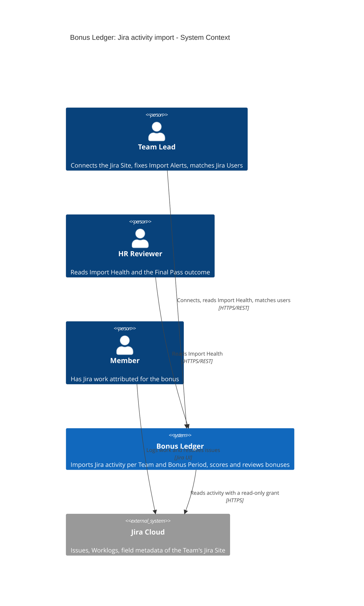
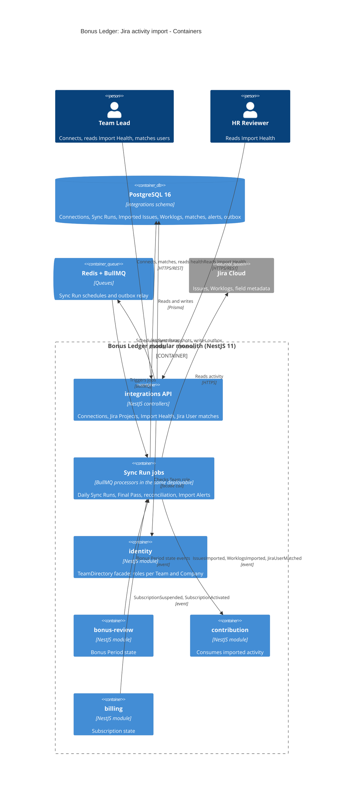
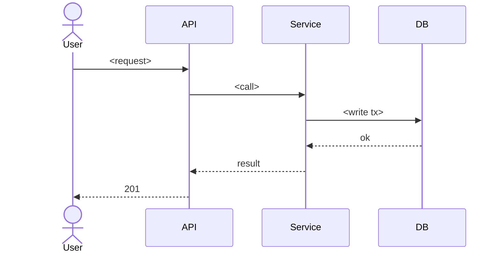

# Software Architecture Document — jira-activity-import

<!-- Stages 04-05 → see sdlc/plugin/skills/architecture-design/SKILL.md -->
<!-- 12 Arc42 sections. Empty sections — <!-- N/A: <one-line reason> -->. -->
<!-- C4 Context (L1) lives inline in §3. C4 Container (L2) lives inline in §5. -->

## 1. Introduction and goals

**Intent.** Bonus Ledger imports each Team's Jira Cloud activity (Imported Issues and Worklogs) into the `integrations` context on a schedule: daily Sync Runs during the open Bonus Period and a Final Pass after month end. The Team Lead connects the Jira Site once, sees Import Health and fixes Import Alerts; Contribution Scoring receives every change exactly once; the HR Reviewer reviews activity that no longer changes once the period leaves Open. Inputs: [PRD](./PRD.md) (Approved, clarified) · [CONTEXT](./CONTEXT.md).

**Top-3 quality goals (1-liners; full scenarios in §10):**

1. **Correctness of activity (idempotency):** 0 duplicated Imported Issues, Worklogs or reported changes across repeated imports of the same window.
2. **Freshness and timeliness:** last successful Sync Run ≤ 26 h old for ≥ 99% of healthy Connections; Final Pass finished ≤ 12 h after month end for ≥ 99% of Connections.
3. **Tenant isolation of personal activity:** no Connection, Import Health or Jira User match is visible or changeable outside its Team and Company.

**Stakeholders.**

| Role | Interest | Sign-off owner? |
|---|---|---|
| Team Lead | Connects the Jira Site, reads Import Health, fixes Import Alerts, matches Jira Users | No |
| HR Reviewer | Reads Import Health; reviews activity that is final after the Final Pass | No |
| Member | Their Jira work is attributed to them | No |
| Tech Lead | SAD approval, ADRs | Yes |
| Security Lead | Jira credential handling, personal data, authorization boundary (PRD §6.1: review Required) | Yes |

<!-- Decision overrides (¶4) — populated by the Step-7 critic resolution loop, empty otherwise. -->

## 2. Constraints

**Technical.**
- TypeScript (strict) on Node.js 22; NestJS 11 modular monolith, one deployable (`docs/architecture-map.md` §Stack, `docs/adr/0001-initial-setup.md`).
- PostgreSQL 16 via Prisma, one Postgres schema and one Prisma client per context; this feature writes only to the `integrations` schema (`docs/adr/0002-persistence-per-context-prisma.md`).
- BullMQ on Redis 7 for scheduled jobs; Redis is a queue, never a system of record.
- Contexts are fixed by `docs/bc-map.md`; cross-context communication is events through each publisher's transactional outbox (at-least-once, consumers deduplicate by `eventId`); synchronous calls only through `public/` facades.
- Jira Cloud only, one Jira Site per Team (PRD §3).
- **Known constraint — the issue key is not stable:** Jira changes the issue key when an issue moves between projects (`.notes/decisions.md` §4), while `.claude/rules/integrations-jira.md` still says "natural key for upsert: Jira issue key". The two sources conflict and AC-09 requires a moved issue to stay one Imported Issue.
- **Past incident (design review) — "mark and sweep" deletes good data:** an earlier proposal swept rows not seen in a run as deleted; it was found wrong because an issue updated later falls outside the previous month's window and would be deleted by mistake (`.notes/decisions.md` §5).

**Organisational.**
- Feature size M; one backend developer; no external deadline (PRD §1). The event-delivery groundwork (scaffold S9: outbox + relay + deduplicating listener) is a prerequisite, not part of this feature (PRD §3).

**Conventions.**
- `CLAUDE.md` §Conventions and `docs/architecture-map.md` §Conventions: `DomainError` with a stable `code` mapped by one global filter; UUIDv7 from `src/shared/ids/`; injected `Clock`; dates in UTC, a Bonus Period is a calendar month in the company's timezone; Conventional Commits scoped by context.
- `customfield_*` ids are mapped to product terms only inside `src/modules/integrations/jira/` (the anti-corruption layer).
- On provider throttling, back off using the provider's retry hint (`.claude/rules/integrations-jira.md`).

**Regulatory / external.**
- Personal data (Worklogs, Jira identities, optional email) is confidential; employee data is deleted 90 days after a company cancels (`SPEC.md`); raw Jira comments are never imported.
- Jira tokens are encrypted at rest and decrypted only in the HTTP client; tokens, headers and full provider payloads are never logged (`.claude/rules/integrations.md`).
- Atlassian rate limits apply per Jira Site; PRD §6 allows ≤ 1% of Sync Runs failing because of throttling.

## 3. Context and scope

Bonus Ledger reads each Team's activity from the Team's Jira Cloud site and hands it to Contribution Scoring; nothing is written back to Jira. The trust boundary is the Jira Cloud API: everything that comes back is mapped and validated in the `integrations` anti-corruption layer before it becomes an Imported Issue or Worklog.

<!-- brownfield: the repo holds the target foundation only (architecture-map mode greenfield-bootstrap); contexts and conventions come from the map. -->

**External systems (in / out):**

| Actor or system | Type | Interaction |
|---|---|---|
| Team Lead | Person | Connects and re-authorises the Jira Site, picks Jira Projects, reads Import Health, matches Jira Users |
| HR Reviewer | Person | Reads Import Health and the Final Pass outcome |
| Member | Person | Indirect: their Jira work is attributed to them |
| Jira Cloud (Atlassian) | System (external) | Authorisation (read-only), issues, Worklogs, field metadata, deleted-worklog feed |
| Bonus Review | System (internal context) | Publishes Bonus Period state changes the import follows |
| Contribution Scoring | System (internal context) | Consumes imported activity changes and attribution |
| Billing | System (internal context) | Publishes subscription suspension and reactivation |
| Identity & Teams | System (internal context) | Answers who is Team Lead / Member / HR Reviewer of which Team and Company |

**C4 Context (L1):**



## 4. Solution strategy

**Target surface(s) (the first decision — what's being built):** `[backend-service]`

The PRD has no screen requirement and the foundation has no frontend (`docs/architecture-map.md` §Frontend: N/A). Sync Runs are BullMQ jobs inside the same NestJS deployable, so no separate `worker` surface is declared. Single surface, reversible by adding one later → inline note, no ADR.

**Top strategic choices (the seeds for ADRs):**

1. **Scheduled, resumable Sync Runs inside `integrations`** — one repeatable BullMQ job per Connection runs daily for the current month, a Final Pass job runs after month end and is retried on schedule until it succeeds or the Bonus Period leaves Open. No manual trigger (PRD §3), no webhooks in v1: polling keeps Jira load predictable and makes freshness ≤ 26 h measurable. → [ADR 0001](./adr/0001-run-scheduled-polling-sync-runs-as-bullmq-jobs.md)
2. **Identify an Imported Issue by the Jira issue id, never by the issue key** — the §2 constraint shows the issue key changes when an issue moves between projects, and the project rule that still names the key would turn every move into a duplicate and break AC-09 and the 0-duplicates NFR. The issue id is the upsert key; the key is stored as a mutable attribute. → [ADR 0002](./adr/0002-identify-imported-issues-by-jira-issue-id.md)
3. **Changes are selected by an `updated` cursor and confirmed by a content hash** — each Sync Run asks Jira for issues updated in the period window since its checkpoint (with a boundary margin), compares a hash of the mapped snapshot, and only real changes reach the outbox with a deterministic `eventId`. This gives the idempotency NFR and resumability. → [ADR 0003](./adr/0003-select-changes-by-updated-cursor-and-content-hash.md)
4. **Deletions and scope exits are found by reconciliation, never by "not seen in this run"** — the §2 past incident showed that sweeping unseen rows deletes good data; withdrawals (AC-27) come from the deleted-worklog feed and an id reconciliation of the period. → [ADR 0004](./adr/0004-detect-deletions-by-period-id-reconciliation.md)

Each tactical decision in later sections should be traceable to one of these strategic seeds. Tactical decisions that *contradict* a strategic choice are red flags — surface them in §11 Risks.

## 5. Building block view

All code lives in the existing `integrations` context (handler / service / repo per feature, provider code under `jira/` as the anti-corruption layer). The context talks to others only through events in its outbox and through `public/` facades; it never reads another context's schema.

**Internal decomposition:**

```
src/modules/integrations/
├── integrations.module.ts
├── public/                 event types: JiraConnected, IssuesImported, WorklogsImported, JiraUserMatched
├── connections/            Connection + Jira Projects: controller / service / repo (US-01, US-02)
├── sync/                   Sync Run scheduler, Final Pass, checkpoints, period read model (US-03)
├── health/                 Import Health query + Import Alerts (US-04, US-05)
├── matching/               Jira User ↔ Member matches, "not on this Team" marks (US-06, US-08)
├── jira/                   ACL: OAuth client, REST client with back-off, mapper (customfield_* only here)
└── db/                     schema.prisma, migrations/, client.ts (integrations schema + outbox)
```

**C4 Container (L2):**



**Building-block decisions:**

- **Attribution travels as events from `integrations`.** A Jira User match, unmatch or "not on this Team" mark is written with a `JiraUserMatched` outbox event in the same transaction; Contribution Scoring re-attributes the activity of every Open Bonus Period at once, without a Sync Run (AC-19, AC-28, AC-29). → [ADR 0005](./adr/0005-publish-jira-user-matches-as-events-for-immediate-attribution.md)
- **The import follows the Bonus Period from Bonus Review events.** `integrations` keeps a local read model of each Team's Bonus Periods from `BonusPeriodOpened`, a new `BonusPeriodReviewStarted` and `BonusPeriodClosed`; Sync Runs and attribution changes stop for a period as soon as it leaves Open (AC-22, AC-26). → [ADR 0006](./adr/0006-follow-bonus-period-state-through-bonus-review-events.md)

## 6. Runtime view

<!-- 🎯 Навіщо: ПОТІК У RUNTIME для 1-2 критичних сценаріїв. Хто з ким коли і у якому     -->
<!--           порядку говорить. Без §6 §5 — лише купа коробок без життя.                  -->
<!-- 📋 Що писати: Mermaid sequenceDiagram. Учасники — імена з §5 (не вигадуй нові!).      -->
<!--           Повідомлення семантичні («складає чорновик»), БЕЗ HTTP-методів/шляхів —     -->
<!--           ендпоінт-рівневі sequence-діаграми зʼявляться у stage 06 (api-forge).        -->
<!-- ⏳ RESERVED FOR SEQUENCES: architecture-design сіє лише primary flow(s) тут.          -->
<!--           complete-sequence-diagrams (stage 06) ДОПОВНЮЄ §6 кожним критичним flow /    -->
<!--           кожним §5 AC — без обмеження. Не намагайся покрити все тут.                  -->
<!-- 📌 Приклад: «methodist → web-app: складає чорновик → web-app → content-api: зберегти». -->

**Critical flow 1: <flow name>**



<!-- For XS/S: 1 flow above is enough. For M+: add 2-4 more (e.g. failure-mode flow, async flow). -->

**Critical flow 2: <e.g. async event propagation>** — <if applicable, otherwise N/A>.

## 7. Deployment view

<!-- 🎯 Навіщо: ТОПОЛОГІЯ, яку DevOps має знати без читання Helm-чартів — скільки реплік,  -->
<!--           де живе фоновий обробник, ПРИ ЯКИХ ЧИСЛАХ масштабуємось.                     -->
<!-- 📋 Що писати: 2-3 речення про топологію + метрики + алерти + конкретні числа-пороги.   -->
<!-- 📌 Приклад: «500 IC → партиціонування за кварталом» (не «при зростанні подумаємо»).    -->
<!-- 🎯 Можна N/A для XS/S функцій, що переюзають існуюче розгортання без змін.            -->

<Topology in 2-3 sentences. Where it runs (k8s / VM / serverless), replicas, scaling thresholds.>

**Monitoring:**
- <Metrics — e.g. Prometheus `<metric_name>`>
- <Alerts — e.g. "outbox lag > 10 min → page on-call">
- <Tracing — e.g. OpenTelemetry HTTP spans>

**Scaling thresholds:**
- <e.g. 500 IC × 5 goals × 26 checkpoints/Q = 65k rows/year — comfortable in one table>
- <e.g. partitioning by quarter at >500k rows/year>

<!-- For XS/S that doesn't change deployment: <!-- N/A: feature reuses existing deployment unit -->. -->

## 8. Crosscutting concepts

<!-- 🎯 Навіщо: НАСКРІЗНІ ПАТЕРНИ, які перетинають кілька модулів: логування, помилки,    -->
<!--           авторизація, ID strategy, outbox, кеш. ⭐ Друга найгустіша секція.          -->
<!--           Якщо патерн всередині одного модуля — він НЕ сюди. Якщо це конвенція        -->
<!--           проєкту в цілому — у CLAUDE.md.                                              -->
<!-- 📋 Що писати: таблиця концепт / конвенція / де визначено. Один рядок на концепт.      -->
<!-- 📌 Приклад: «UUID v7 (час+випадковий, сортується) у app-layer» — як default з CLAUDE.md. -->

| Concept | Convention | Where defined |
|---|---|---|
| Logging | <e.g. structured slog, fields `module=<name>`> | <CLAUDE.md §X or here> |
| Authentication | <e.g. JWT via session middleware> | <CLAUDE.md §X> |
| Error handling | <e.g. domain sentinel → ports/errors.go → apperr JSON> | <CLAUDE.md §X> |
| ID strategy | <e.g. UUID v7 in app layer> | <CLAUDE.md §X> |
| Internationalisation | <e.g. N/A, English only> | — |
| Observability | <e.g. OpenTelemetry on HTTP boundaries> | — |
| Outbox / events | <module-specific patterns, if any> | <here> |

## 9. Architecture decisions

<!-- 🎯 Навіщо: ЗВОРОТНИЙ ІНДЕКС на папку adr/. `ls adr/` дає файли, §9 дає семантику —    -->
<!--           чому вони існують, до якого зрізу SAD привʼязані, у якому статусі.           -->
<!-- 📋 Що писати: таблиця з 4 колонками. Один рядок на ADR. Mixed status — це OK.         -->
<!-- 📌 Приклад: «0001 | Зберігати урок як таблицю блоків | Accepted | §4».                -->

| # | Title | Status | Section |
|---|---|---|---|
| <NNNN> | <imperative — e.g. "Use sliding window for rate limiting"> | Accepted | §<N> |
| <NNNN> | <imperative — e.g. "Co-locate outbox worker in API process"> | Accepted | §<N> |

ADR files live under `docs/features/<slug>/adr/NNNN-<title>.md`.

## 10. Quality requirements

<!-- 🎯 Навіщо: ДЕРЕВО ЯКОСТЕЙ (Quality Tree) — беремо мету з §1 і розкладаємо на          -->
<!--           конкретні листя: тести, метрики, конфіги, drill-и. ⭐ Без §10 §1 — це       -->
<!--           маніфест. З §10 кожна декларація мапиться на щось, ЩО МОЖНА ДОВЕСТИ.        -->
<!-- 📋 Що писати: на кожну якість з §1 — When / Then / How verify. Числа з PRD §6 NFR     -->
<!--           ДОСЛІВНО (не округлюй p95 ≤250мс до ≤300мс — це F6-помилка критика).        -->
<!-- 📌 Приклад: «p95 ≤500 мс на UPDATE блоку, перевіримо k6 load test 100 req/s».        -->

Each top-3 goal from §1 expanded into a full scenario:

**QG-1. <quality attribute>**
- **When:** <trigger condition>
- **Then:** <expected behavior with numbers from PRD NFR>
- **How verify:** <test / chaos drill / load test / observability>

**QG-2. <quality attribute>**
- **When:** <trigger>
- **Then:** <expected>
- **How verify:** <how>

**QG-3. <quality attribute>**
- **When:** <trigger>
- **Then:** <expected>
- **How verify:** <how>

## 11. Risks and technical debt

<!-- 🎯 Навіщо: ⭐ збирає ВСЕ, що може зламатись — і не лише технічне. Без §11 ризики   -->
<!--           обговорюються на стендапах і губляться; борг лишається у голові того,    -->
<!--           хто його прийняв.                                                          -->
<!-- 📋 Що писати: таблиця ризик/борг — серйозність — мітигація — власник. Технічний    -->
<!--           борг окремою секцією.                                                      -->
<!-- 📌 Приклад: «EM не пушить — member не оновлює дані | High | …». Перший ризик —      -->
<!--           часто продуктовий, не технічний. Це нормально.                            -->

<!-- Severity column literals: Low / Medium / High for regular risks; "Open question" for rows
     created by Step-7 `Save as Open Question` resolutions (see references/socratic-loop.md). -->

| Risk / debt | Severity | Mitigation | Owner |
|---|---|---|---|
| <e.g. Outbox lag may reach hours during downstream outage> | Medium | <Alert >10 min, on-call playbook, retry backoff> | <DevOps> |
| <e.g. No event schema versioning in v1> | Medium | <ADR-NNNN planned for v2, graceful handling of unknown fields> | <Backend> |
| Open architectural decision: <decision-headline> | Open question | Resolve before <stage trigger or YYYY-MM-DD>; <inline rationale from Step-7 Save-as-OQ> | <owner> |

**Accepted debt (acceptable in v1, plan to fix later):**
- <e.g. Goal entity is not versioned (immutable) — OK for v1, may need audit versioning in v2>

## 12. Glossary

<!-- 🎯 Навіщо: ⭐ СЛОВНИК ДОМЕНУ, який припиняє суперечки через рік («checkpoint —      -->
<!--           weekly чи biweekly? Quarter — календарний чи фіскальний?»).                -->
<!-- 📋 Що писати: таблиця термін / значення. Бізнес-терміни + технічні вперемішку.       -->
<!--           Один термін може мати дві мови у заголовку: «Goal (Обʼєктив)».              -->
<!-- 📌 Приклад: «Lesson | урок усередині курсу, що складається з блоків (text, video)». -->

| Term | Meaning |
|---|---|
| <e.g. Goal> | <quarterly intent in statement form> |
| <e.g. KR> | <Key Result — measurable target linked to a Goal> |
| <e.g. Checkpoint> | <bi-weekly progress update on a KR> |
