# Software Architecture Document — jira-activity-import

<!-- Stages 04-05 → see sdlc/plugin/skills/architecture-design/SKILL.md -->
<!-- 12 Arc42 sections. Empty sections are marked N/A with a one-line reason. -->
<!-- C4 Context (L1) lives inline in §3. C4 Container (L2) lives inline in §5. -->

## 1. Introduction and goals

**Intent.** Bonus Ledger imports each Team's Jira Cloud activity (Imported Issues and Worklogs) into the `integrations` context on a schedule: daily Sync Runs during the open Bonus Period and a Final Pass after month end. The Team Lead connects the Jira Site once, sees Import Health and fixes Import Alerts; Contribution Scoring receives every change exactly once; the HR Reviewer reviews activity that no longer changes once the period leaves Open. Inputs: [PRD](./PRD.md) (Approved, clarified) · [CONTEXT](./CONTEXT.md).

**Top-3 quality goals (1-liners; full scenarios in §10):**

1. **Correctness of activity (idempotency):** 0 duplicated Imported Issues, Worklogs or reported changes across repeated imports of the same window.
2. **Freshness and timeliness:** last successful Sync Run ≤ 26 h old for ≥ 99% of healthy Connections; Final Pass finished ≤ 12 h after month end for ≥ 99% of Connections.
3. **Tenant isolation of personal activity:** no Connection, Import Health or Jira User match is visible or changeable outside its Team and Company.

**Stakeholders.**

| Role | Interest | Sign-off owner? |
|---|---|---|
| Team Lead | Connects the Jira Site, reads Import Health, fixes Import Alerts, matches Jira Users | No |
| HR Reviewer | Reads Import Health; reviews activity that is final after the Final Pass | No |
| Member | Their Jira work is attributed to them | No |
| Tech Lead | SAD approval, ADRs | Yes |
| Security Lead | Jira credential handling, personal data, authorization boundary (PRD §6.1: review Required) | Yes |

<!-- Decision overrides (¶4) — populated by the Step-7 critic resolution loop, empty otherwise. -->

## 2. Constraints

**Technical.**
- TypeScript (strict) on Node.js 22; NestJS 11 modular monolith, one deployable (`docs/architecture-map.md` §Stack, `docs/adr/0001-initial-setup.md`).
- PostgreSQL 16 via Prisma, one Postgres schema and one Prisma client per context; this feature writes only to the `integrations` schema (`docs/adr/0002-persistence-per-context-prisma.md`).
- BullMQ on Redis 7 for scheduled jobs; Redis is a queue, never a system of record.
- Contexts are fixed by `docs/bc-map.md`; cross-context communication is events through each publisher's transactional outbox (at-least-once, consumers deduplicate by `eventId`); synchronous calls only through `public/` facades.
- Jira Cloud only, one Jira Site per Team (PRD §3).
- **Known constraint — the issue key is not stable:** Jira changes the issue key when an issue moves between projects (`.notes/decisions.md` §4), while `.claude/rules/integrations-jira.md` still says "natural key for upsert: Jira issue key". The two sources conflict and AC-09 requires a moved issue to stay one Imported Issue.
- **Past incident (design review) — "mark and sweep" deletes good data:** an earlier proposal swept rows not seen in a run as deleted; it was found wrong because an issue updated later falls outside the previous month's window and would be deleted by mistake (`.notes/decisions.md` §5).

**Organisational.**
- Feature size M; one backend developer; no external deadline (PRD §1). The event-delivery groundwork (scaffold S9: outbox + relay + deduplicating listener) is a prerequisite, not part of this feature (PRD §3).

**Conventions.**
- `CLAUDE.md` §Conventions and `docs/architecture-map.md` §Conventions: `DomainError` with a stable `code` mapped by one global filter; UUIDv7 from `src/shared/ids/`; injected `Clock`; dates in UTC, a Bonus Period is a calendar month in the company's timezone; Conventional Commits scoped by context.
- `customfield_*` ids are mapped to product terms only inside `src/modules/integrations/jira/` (the anti-corruption layer).
- On provider throttling, back off using the provider's retry hint (`.claude/rules/integrations-jira.md`).

**Regulatory / external.**
- Personal data (Worklogs, Jira identities, optional email) is confidential; employee data is deleted 90 days after a company cancels (`SPEC.md`); raw Jira comments are never imported.
- Jira tokens are encrypted at rest and decrypted only in the HTTP client; tokens, headers and full provider payloads are never logged (`.claude/rules/integrations.md`).
- Atlassian rate limits apply per Jira Site; PRD §6 allows ≤ 1% of Sync Runs failing because of throttling.

## 3. Context and scope

Bonus Ledger reads each Team's activity from the Team's Jira Cloud site and hands it to Contribution Scoring; nothing is written back to Jira. The trust boundary is the Jira Cloud API: everything that comes back is mapped and validated in the `integrations` anti-corruption layer before it becomes an Imported Issue or Worklog.

<!-- brownfield: the repo holds the target foundation only (architecture-map mode greenfield-bootstrap); contexts and conventions come from the map. -->

**External systems (in / out):**

| Actor or system | Type | Interaction |
|---|---|---|
| Team Lead | Person | Connects and re-authorises the Jira Site, picks Jira Projects, reads Import Health, matches Jira Users |
| HR Reviewer | Person | Reads Import Health and the Final Pass outcome |
| Member | Person | Indirect: their Jira work is attributed to them |
| Jira Cloud (Atlassian) | System (external) | Authorisation (read-only), issues, Worklogs, field metadata, deleted-worklog feed |
| Bonus Review | System (internal context) | Publishes Bonus Period state changes the import follows |
| Contribution Scoring | System (internal context) | Consumes imported activity changes and attribution |
| Billing | System (internal context) | Publishes subscription suspension and reactivation |
| Identity & Teams | System (internal context) | Answers who is Team Lead / Member / HR Reviewer of which Team and Company |

**C4 Context (L1):**

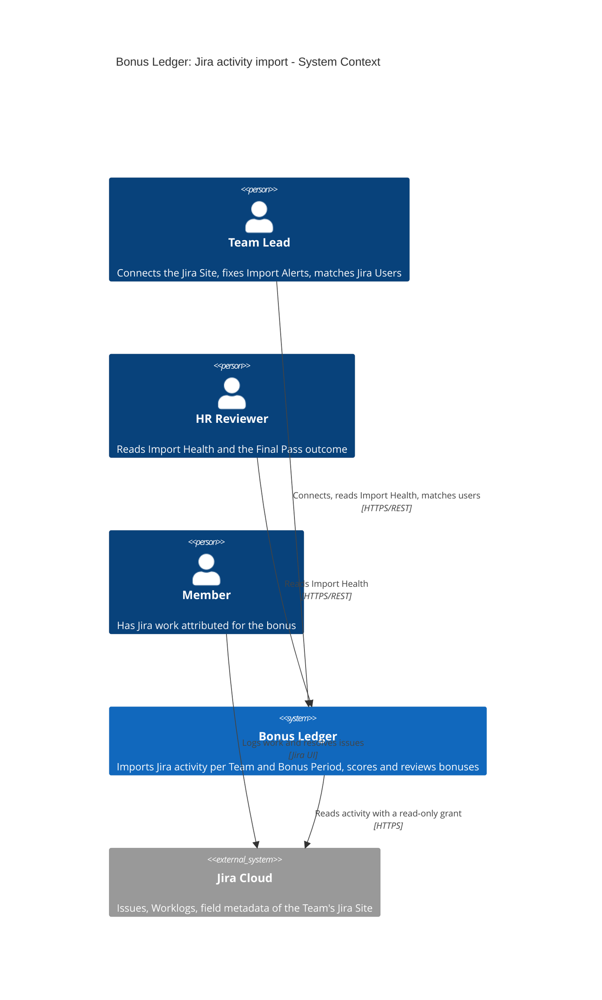

## 4. Solution strategy

**Target surface(s) (the first decision — what's being built):** `[backend-service]`

The PRD has no screen requirement and the foundation has no frontend (`docs/architecture-map.md` §Frontend: N/A). Sync Runs are BullMQ jobs inside the same NestJS deployable, so no separate `worker` surface is declared. Single surface, reversible by adding one later → inline note, no ADR.

**Top strategic choices (the seeds for ADRs):**

1. **Scheduled, resumable Sync Runs inside `integrations`** — one repeatable BullMQ job per Connection runs daily for the current month, a Final Pass job runs after month end and is retried on schedule until it succeeds or the Bonus Period leaves Open. No manual trigger (PRD §3), no webhooks in v1: polling keeps Jira load predictable and makes freshness ≤ 26 h measurable. → [ADR 0001](./adr/0001-run-scheduled-polling-sync-runs-as-bullmq-jobs.md)
2. **Identify an Imported Issue by the Jira issue id, never by the issue key** — the §2 constraint shows the issue key changes when an issue moves between projects, and the project rule that still names the key would turn every move into a duplicate and break AC-09 and the 0-duplicates NFR. The issue id is the upsert key; the key is stored as a mutable attribute. → [ADR 0002](./adr/0002-identify-imported-issues-by-jira-issue-id.md)
3. **Changes are selected by an `updated` cursor over the period's membership and confirmed by a content hash** — an issue belongs to a Bonus Period when it has a Worklog dated in the period or was resolved in the period (company timezone), never by its `updated` time; each Sync Run asks Jira for member issues updated since the checkpoint of (Connection, Jira Project, Bonus Period) with a boundary margin, compares a hash of the mapped snapshot, and only real changes reach the outbox with a deterministic `eventId`. A checkpoint is empty for a newly added Jira Project and is reset for every Open period when a Connection is re-authorised, so those runs import the whole period (AC-05, AC-16). This gives the idempotency NFR and resumability. → [ADR 0003](./adr/0003-select-changes-by-updated-cursor-and-content-hash.md)
4. **Deletions and scope exits are found by reconciliation, never by "not seen in this run"** — the §2 past incident showed that sweeping unseen rows deletes good data; withdrawals (AC-27) come from the deleted-worklog feed and a reconciliation against the period's membership query (not an `updated` window). → [ADR 0004](./adr/0004-detect-deletions-by-period-id-reconciliation.md)

Each tactical decision in later sections should be traceable to one of these strategic seeds. Tactical decisions that *contradict* a strategic choice are red flags — surface them in §11 Risks.

## 5. Building block view

All code lives in the existing `integrations` context (handler / service / repo per feature, provider code under `jira/` as the anti-corruption layer). The context talks to others only through events in its outbox and through `public/` facades; it never reads another context's schema.

**Internal decomposition:**

```
src/modules/integrations/
├── integrations.module.ts
├── public/                 event types: JiraConnected, IssuesImported, WorklogsImported, JiraUserMatched
├── connections/            Connection + Jira Projects: controller / service / repo (US-01, US-02)
├── sync/                   Sync Run scheduler, Final Pass, checkpoints, period read model (US-03)
├── health/                 Import Health query + Import Alerts (US-04, US-05)
├── matching/               Jira User ↔ Member matches, "not on this Team" marks (US-06, US-08)
├── jira/                   ACL: OAuth client, REST client with back-off, mapper (customfield_* only here)
└── db/                     schema.prisma, migrations/, client.ts (integrations schema + outbox)
```

**C4 Container (L2):**

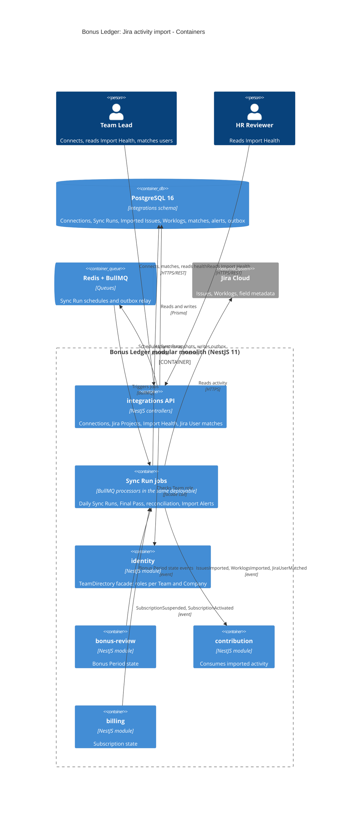

**Building-block decisions:**

- **Attribution travels as events from `integrations`.** A Jira User match, unmatch or "not on this Team" mark is written with a `JiraUserMatched` outbox event in the same transaction; Contribution Scoring re-attributes the activity of every Open Bonus Period at once, without a Sync Run (AC-19, AC-28, AC-29). → [ADR 0005](./adr/0005-publish-jira-user-matches-as-events-for-immediate-attribution.md)
- **The import follows the Bonus Period from Bonus Review events.** `integrations` keeps a local read model of each Team's Bonus Periods from `BonusPeriodOpened`, a new `BonusPeriodReviewStarted` and `BonusPeriodClosed`; Sync Runs and attribution changes stop for a period as soon as it leaves Open (AC-22, AC-26). → [ADR 0006](./adr/0006-follow-bonus-period-state-through-bonus-review-events.md)

## 6. Runtime view

Participants are the §5 containers. Messages are semantic; endpoint-level detail is api-forge's job.

**Critical flow 1: daily Sync Run for an Open Bonus Period (US-03, AC-07, AC-08, AC-10)**

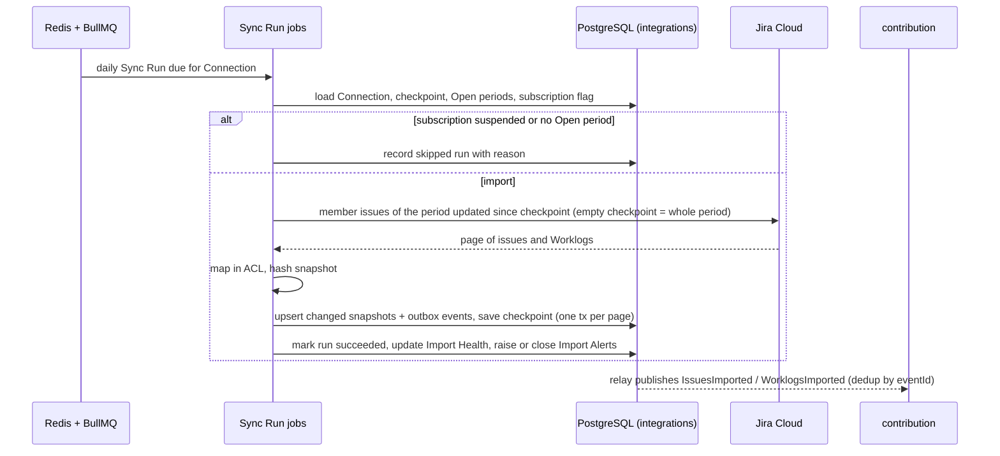

**Critical flow 2: access lost during a Sync Run (AC-15)**

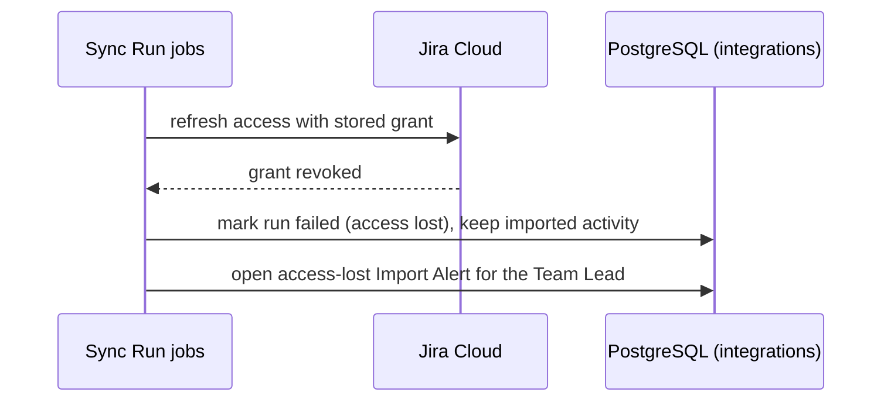

### Connect the Team's Jira Site

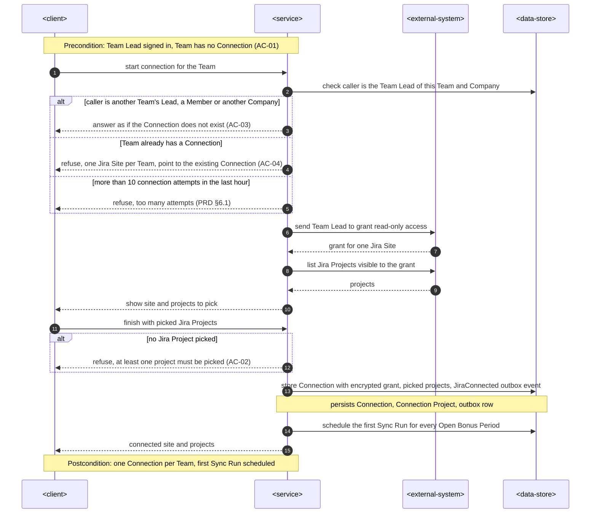

### Change the Team's Jira Projects

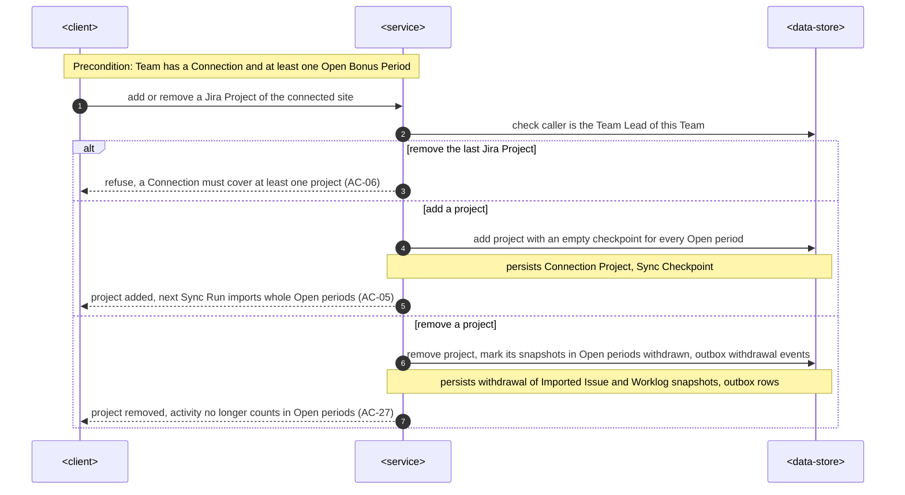

### Scheduled daily Sync Run

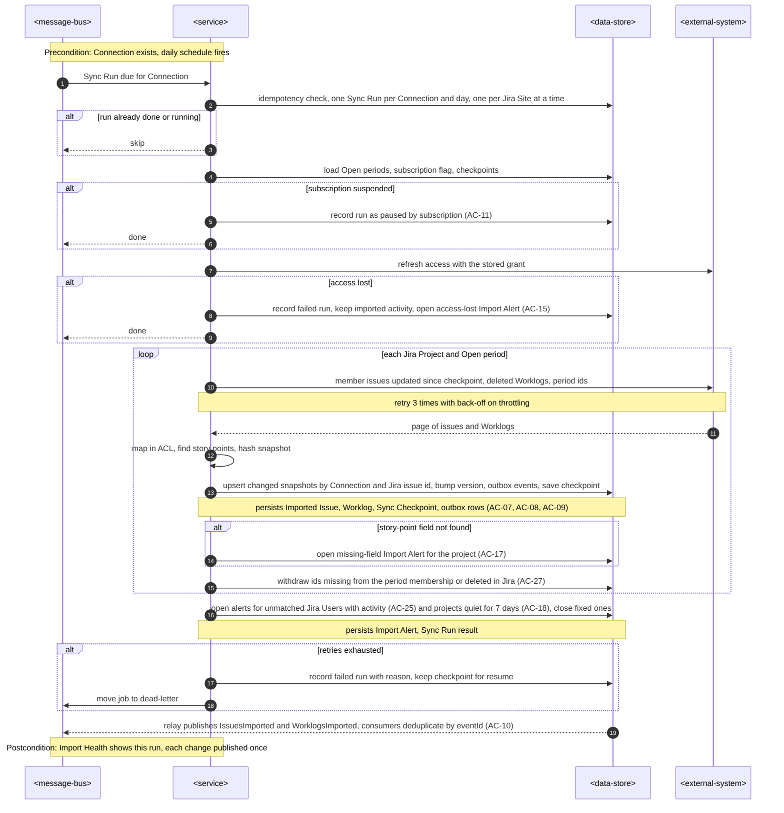

### Final Pass with scheduled retry

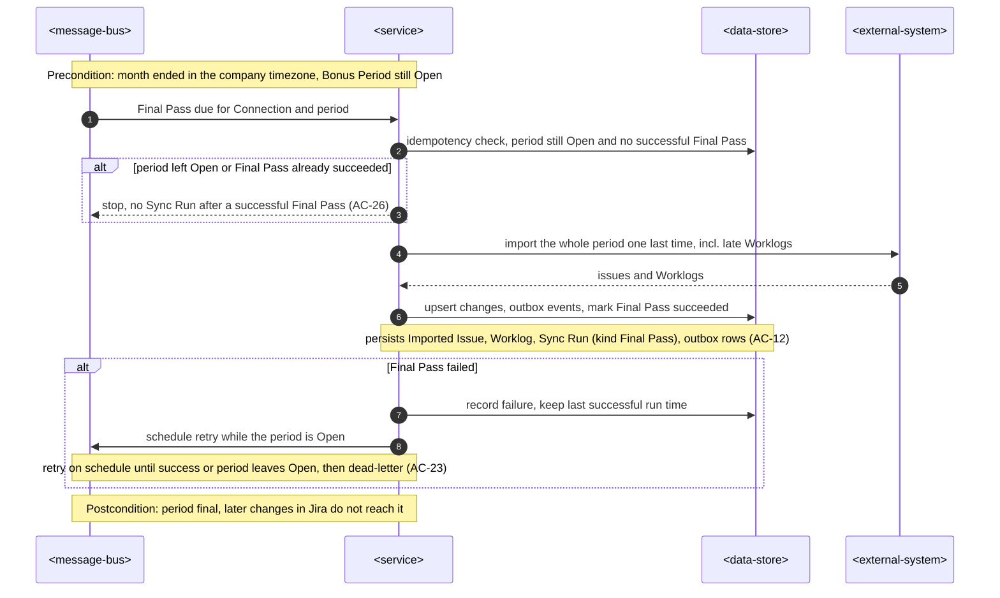

### Re-authorise a Connection

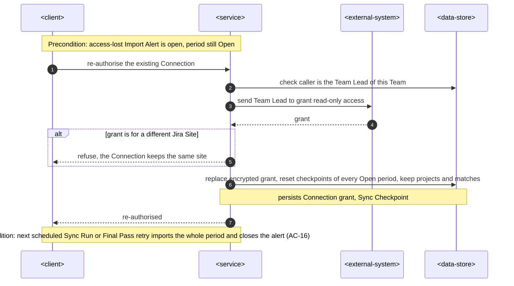

### Read Import Health

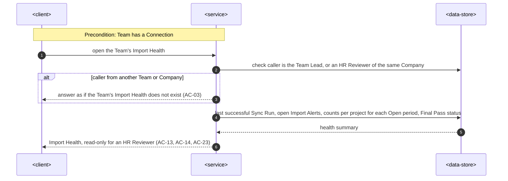

### Match Jira Users to Members

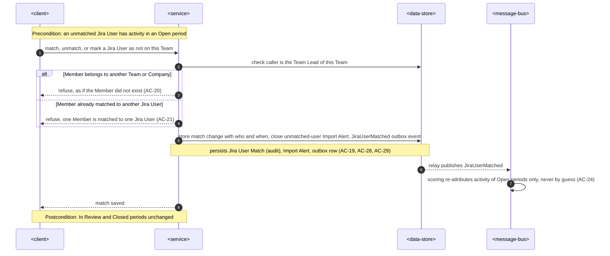

### Follow Bonus Period state

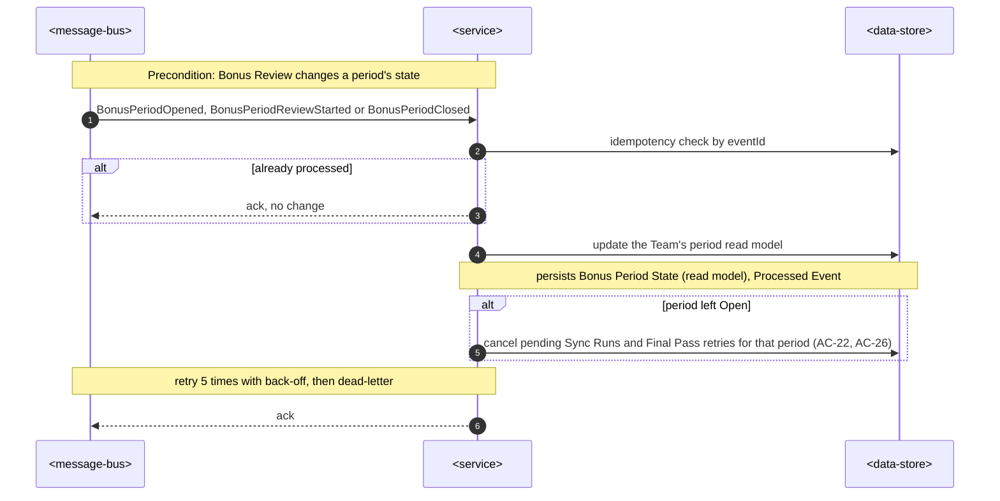

### Coverage: US/AC → flows

| ID | Realized by (§6 heading) | How | Note |
|---|---|---|---|
| US-01 | Connect the Team's Jira Site | flow | |
| US-02 | Change the Team's Jira Projects | flow | |
| US-03 | Scheduled daily Sync Run, Final Pass with scheduled retry | flow | |
| US-04 | Read Import Health | flow | |
| US-05 | Scheduled daily Sync Run, Re-authorise a Connection | flow | |
| US-06 | Match Jira Users to Members | flow | |
| US-07 | Final Pass with scheduled retry, Follow Bonus Period state | flow | |
| US-08 | Match Jira Users to Members | flow | |
| AC-01 | Connect the Team's Jira Site | flow | |
| AC-02 | Connect the Team's Jira Site | branch | `alt no Jira Project picked` |
| AC-03 | Connect the Team's Jira Site | branch | `alt caller is another Team's Lead, a Member or another Company` |
| AC-04 | Connect the Team's Jira Site | branch | `else Team already has a Connection` |
| AC-05 | Change the Team's Jira Projects | branch | `else add a project` |
| AC-06 | Change the Team's Jira Projects | branch | `alt remove the last Jira Project` |
| AC-07 | Scheduled daily Sync Run | flow | |
| AC-08 | Scheduled daily Sync Run | flow | upsert by Connection and Jira issue id + version |
| AC-09 | Scheduled daily Sync Run | flow | identity by Jira issue id (ADR 0002) |
| AC-10 | Scheduled daily Sync Run | flow | relay + consumer dedup by eventId |
| AC-11 | Scheduled daily Sync Run | branch | `alt subscription suspended` |
| AC-12 | Final Pass with scheduled retry | flow | |
| AC-13 | Read Import Health | flow | |
| AC-14 | Read Import Health | flow | read-only for an HR Reviewer |
| AC-15 | Scheduled daily Sync Run | branch | `alt access lost` |
| AC-16 | Re-authorise a Connection | flow | |
| AC-17 | Scheduled daily Sync Run | branch | `alt story-point field not found` |
| AC-18 | Scheduled daily Sync Run | flow | quiet-project alert step |
| AC-19 | Match Jira Users to Members | flow | |
| AC-20 | Match Jira Users to Members | branch | `alt Member belongs to another Team or Company` |
| AC-21 | Match Jira Users to Members | branch | `else Member already matched to another Jira User` |
| AC-22 | Follow Bonus Period state | branch | `alt period left Open` |
| AC-23 | Final Pass with scheduled retry, Read Import Health | branch | `alt Final Pass failed` |
| AC-24 | Match Jira Users to Members | flow | attribution never by guess |
| AC-25 | Scheduled daily Sync Run | flow | unmatched-user alert step |
| AC-26 | Final Pass with scheduled retry, Follow Bonus Period state | branch | `alt period left Open or Final Pass already succeeded` |
| AC-27 | Change the Team's Jira Projects, Scheduled daily Sync Run | branch | `else remove a project`; withdraw step |
| AC-28 | Match Jira Users to Members | flow | mark as not on this Team |
| AC-29 | Match Jira Users to Members | flow | unmatch and re-match |

Coverage: 8/8 user stories · 29/29 ACs — 0 non-runtime N/A.

**Flags:** `<message-bus>` stands for the §5 queue and the outbox relay, both declared · persist notes name new entities for generate-data-model: Connection Project, Sync Checkpoint, Jira User Match, Import Alert, Bonus Period State (read model), Processed Event · the re-attribution step in "Match Jira Users to Members" is Contribution Scoring work (SAD §11).


## 7. Deployment view

<!-- N/A: the feature reuses the single modular-monolith deployable, Postgres and Redis from the foundation; it adds no deployment unit. Its metrics and alerts are listed in §8 Observability. -->

N/A — the feature reuses the existing single deployable, PostgreSQL 16 and Redis; Sync Run jobs run in the same process (§4). Monitoring is in §8 (Observability).

## 8. Crosscutting concepts

| Concept | Convention | Where defined |
|---|---|---|
| Logging | Structured logs with `context=integrations`, `connectionId`, `syncRunId`; never tokens, headers or provider payloads | `.claude/rules/integrations.md` |
| Authentication to Jira | Atlassian OAuth 2.0 (3LO) with read-only scopes; refresh token encrypted at rest and decrypted only in the Jira client; the Team Lead of the Team (including a new Team Lead after the previous one left) re-authorises the same Jira Site | [ADR 0007](./adr/0007-authorise-jira-with-oauth-3lo-and-encrypted-refresh-token.md) |
| Authorization | Role checked per request through Identity's `TeamDirectory` facade; another Team's or Company's Connection, Member or Import Health answers exactly like "does not exist" | PRD §6.1, reference `identity` module |
| Error handling | `DomainError` subclasses with stable codes (e.g. connection already exists, last project, Member already matched); one global filter maps them | `docs/architecture-map.md` §Conventions |
| ID strategy | UUIDv7 from `src/shared/ids/` for own rows; Jira issue id and Jira account id stored as provider ids | [ADR 0002](./adr/0002-identify-imported-issues-by-jira-issue-id.md) |
| Period attribution | Worklogs belong to the Bonus Period of the day they cover; story points to the period of the issue's resolution date, in the company's timezone (PRD §8 default adopted) | here |
| Idempotency / events | Snapshot key = (Connection id, Jira issue or Worklog id); every real change bumps the snapshot version; deterministic `eventId` = hash of (Connection id, entity id, version), so a retried write reuses the id and an A→B→A change or a re-added project gets a new one; outbox in the same transaction; consumers deduplicate | [ADR 0003](./adr/0003-select-changes-by-updated-cursor-and-content-hash.md) |
| Deletions / scope exits | Deleted-worklog feed + period id reconciliation; withdrawals are published, never silently dropped | [ADR 0004](./adr/0004-detect-deletions-by-period-id-reconciliation.md) |
| Rate limiting | Back off with the provider's retry hint (`.claude/rules/integrations-jira.md`); at most 1 Sync Run at a time per Jira Site (decision of this SAD); 10 connection attempts per Team Lead per hour (PRD §6.1) | rule file, here, PRD §6.1 |
| Observability | Metrics: last successful Sync Run age per Connection, Final Pass finish vs month end, Sync Run duration, throttling failures; alert when a healthy Connection's last success is > 26 h old | PRD §6 |
| Internationalisation | N/A, English only | — |

## 9. Architecture decisions

| # | Title | Status | Section |
|---|---|---|---|
| 0001 | Run scheduled polling Sync Runs as BullMQ jobs | Accepted | §4 |
| 0002 | Identify Imported Issues by Jira issue id | Accepted | §4 |
| 0003 | Select changes by updated cursor and content hash | Accepted | §4 |
| 0004 | Detect deletions by period id reconciliation | Accepted | §4 |
| 0005 | Publish Jira User matches as events for immediate attribution | Accepted | §5 |
| 0006 | Follow Bonus Period state through Bonus Review events | Accepted | §5 |
| 0007 | Authorise Jira with OAuth 3LO and an encrypted refresh token | Accepted | §8 |

ADR files live under `docs/features/jira-activity-import/adr/NNNN-<title>.md`.

## 10. Quality requirements

**QG-1. Correctness of activity (idempotency)**
- **When:** the same Bonus Period window is imported again with nothing changed in Jira, or an issue moves to another project of the same Team.
- **Then:** 0 duplicated Imported Issues, Worklogs or reported changes across repeated imports of the same window; the moved issue stays one Imported Issue.
- **How verify:** automated re-run test in CI on recorded fixtures (`test/fixtures/jira/`), including a moved-issue fixture.

**QG-2. Freshness and timeliness**
- **When:** daily Sync Runs and the Final Pass run for healthy Connections.
- **Then:** last successful Sync Run ≤ 26 h old for ≥ 99% of healthy Connections; Final Pass finished ≤ 12 h after month end (company timezone) for ≥ 99% of Connections; Sync Run p95 ≤ 15 min for a Connection with ≤ 5,000 issues changed in the window; ≤ 1% of Sync Runs fail because the provider limited requests.
- **How verify:** age of the last successful Sync Run per Connection, checked hourly; Final Pass finish time vs month end, per Bonus Period; Sync Run start/finish times; Sync Run failure reasons, monthly.

**QG-3. Tenant isolation and responsiveness of Import Health**
- **When:** a Team Lead of another Team, a Member, or a user of another Company asks for a Connection, Import Health or a Jira User match; and when Import Health is opened.
- **Then:** the answer is identical to "does not exist"; an Import Alert is visible ≤ 15 min after the Sync Run that detected the problem; Import Health view p95 ≤ 300 ms.
- **How verify:** e2e authorization tests per role (AC-03, AC-14, AC-20); alert creation time vs Sync Run finish time; request latency for the Import Health view.

## 11. Risks and technical debt

| Risk / debt | Severity | Mitigation | Owner |
|---|---|---|---|
| `BonusPeriodReviewStarted` does not exist in `docs/bc-map.md` yet; Bonus Review must publish it | High | Add it to `bc-map.md` and the bonus-review `public/` types before the first sync task (ADR 0006) | Tech Lead |
| Jira API details (deleted-worklog feed, JQL minute precision) were not checked against Atlassian docs | Medium | Spike on a sandbox site with recorded fixtures before ADR 0003/0004 tasks | Backend |
| Atlassian rate limits on large sites could push throttling failures above 1% | Medium | Per-site concurrency 1, retry hint back-off, alert on the monthly ratio | Backend |
| Scaffold S9 (outbox + relay) is not built; this feature cannot publish events without it | High | Treat S9 as a hard dependency in break-tasks | Tech Lead |
| `.claude/rules/integrations-jira.md` still names the issue key as the upsert key | Low | Update the rule in the first implementation task (ADR 0002) | Backend |
| `docs/bc-map.md` changes: new `JiraUserMatched` (integrations → contribution), `SubscriptionActivated` billing → integrations, contribution consuming Bonus Period events | High | Update bc-map and the publishers' `public/` types in the first task; break-tasks lists them as prerequisites | Tech Lead |
| Contribution Scoring work outside this feature: re-attribution on `JiraUserMatched`, handling withdrawals (AC-27), tracking which periods are Open | High | Separate tasks owned by the contribution context, scheduled with this feature | Tech Lead |
| Open architectural decision: can two Teams pick the same Jira Project, and does a shared issue count for both? | Open question | Resolve by 2026-12-01 (before break-tasks); current default: allowed — snapshots and `eventId` are scoped per Connection (§8), each Team counts only its own matched Members (PRD §8) | PM + Tech Lead |

**Accepted debt (acceptable in v1, plan to fix later):**
- Polling only, no Jira webhooks — freshness is daily, not near-real-time.
- No backfill: Team Baseline stays empty for the first months (PRD §3).

## 12. Glossary

The canonical glossary is [CONTEXT.md](./CONTEXT.md); this table adds only technical terms used in this SAD.

| Term | Meaning |
|---|---|
| Checkpoint | The `updated` cursor position a Sync Run saved after its last committed page; a resumed run continues from it |
| Content hash | A hash of the mapped Imported Issue or Worklog; equal hashes mean "nothing changed", so nothing is published |
| Reconciliation | Comparing the Jira ids that exist for a period with the ids imported, to find deletions and scope exits |
| Outbox | The `integrations` table written in the same transaction as the state change; a relay publishes its rows as events |
| ACL (anti-corruption layer) | The `jira/` mapper that turns Jira payloads into domain terms; the only place `customfield_*` ids appear |
