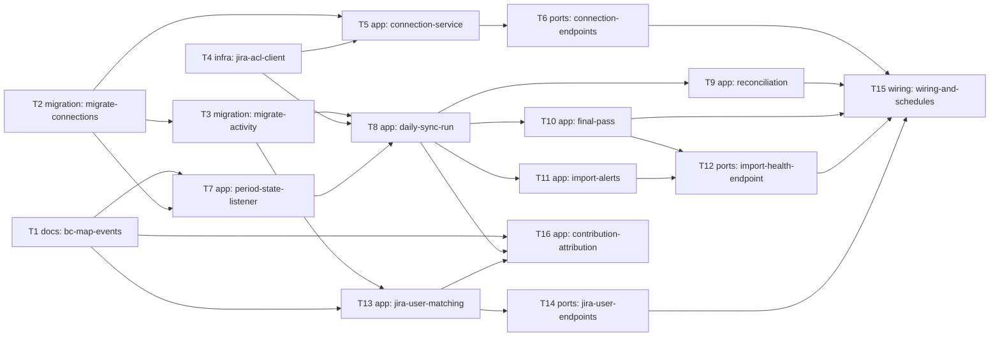

# Epic — jira-activity-import

Scheduled import of each Team's Jira Cloud activity with Import Health, Import Alerts and Jira User matching. Links: [PRD](../PRD.md) · [SAD](../sad.md) · [ADRs](../adr/) · [data-model](../data-model.md) · [openapi.yaml](../contracts/openapi.yaml) · [events.md](../contracts/events.md) · machine contract [tasks.json](./tasks.json).

**Prerequisites outside this epic:** scaffold S8 (jobs) and S9 (outbox + relay + deduplicating listener); the open question on shared Jira Projects (SAD §11, due 2026-12-01).

**Size:** M · 16 tasks · ≈ 7.75 person-days (62 h) (S = 2 h, M = half-day, L = day).

**Parallel branches:** T1, T2 and T4 start together; T9, T10, T11 run in parallel after T8; T13→T14 runs beside the sync branch.

## Dependency graph

## Tasks

- [T1 — Add JiraUserMatched, BonusPeriodReviewStarted and SubscriptionActivated→integrations to the bc-map and public event types](./t1-bc-map-events.md) · docs · S
- [T2 — Promote staged migrations for connections, projects, period states and checkpoints](./t2-migrate-connections.md) · migration · S
- [T3 — Promote staged migrations for sync runs, imported issues, worklogs, Jira users, alerts and processed events](./t3-migrate-activity.md) · migration · S
- [T4 — Build the Jira ACL: OAuth 3LO client, REST client with retry-hint back-off, issue/Worklog mapper](./t4-jira-acl-client.md) · infra · L
- [T5 — Implement Connection and Jira Project use cases with authorization and domain errors](./t5-connection-service.md) · app · M
- [T6 — Expose Connection, authorization, re-authorisation and project endpoints](./t6-connection-endpoints.md) · ports · M
- [T7 — Follow Bonus Period and subscription state from events](./t7-period-state-listener.md) · app · S
- [T8 — Implement the daily Sync Run: cursor, content hash, versioned upsert, outbox events](./t8-daily-sync-run.md) · app · L
- [T9 — Detect deletions and scope exits by period reconciliation and publish withdrawals](./t9-reconciliation.md) · app · M
- [T10 — Schedule the Final Pass with retries while the period is Open](./t10-final-pass.md) · app · M
- [T11 — Raise and close Import Alerts for access, missing field, unmatched users and quiet projects](./t11-import-alerts.md) · app · M
- [T12 — Expose Import Health for the Team Lead and HR Reviewers](./t12-import-health-endpoint.md) · ports · M
- [T13 — Implement Jira User match, unmatch and not-on-this-Team with audit and events](./t13-jira-user-matching.md) · app · M
- [T14 — Expose Jira User list and matching endpoints](./t14-jira-user-endpoints.md) · ports · M
- [T15 — Wire the integrations module, BullMQ schedules and metrics](./t15-wiring-and-schedules.md) · wiring · S
- [T16 — Consume activity, withdrawals and JiraUserMatched in contribution (separate context work)](./t16-contribution-attribution.md) · app · M
